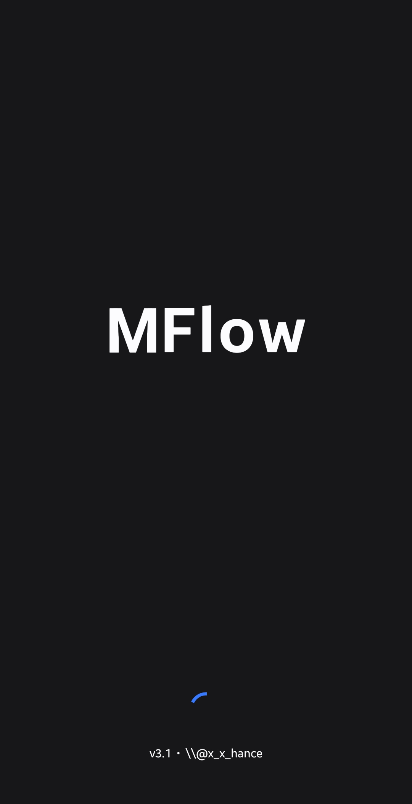
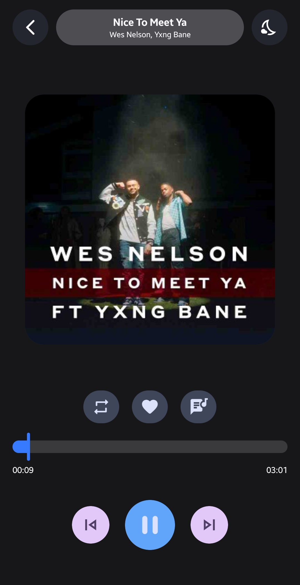
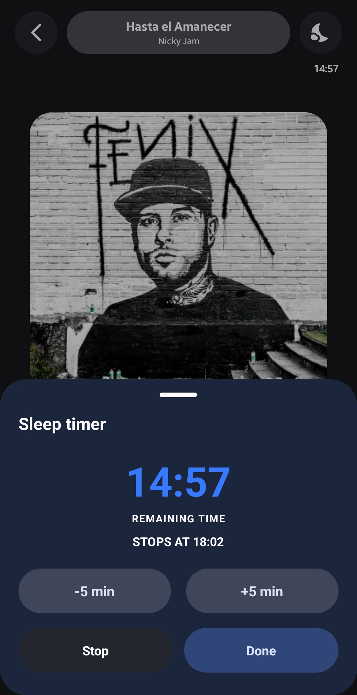
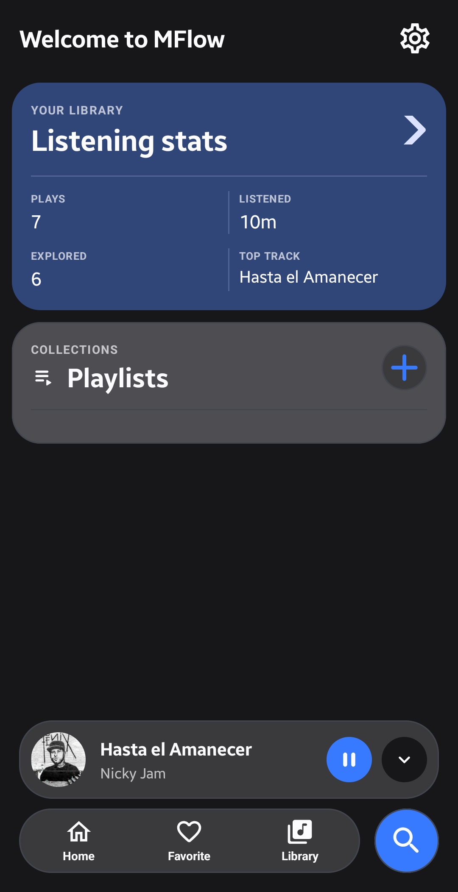
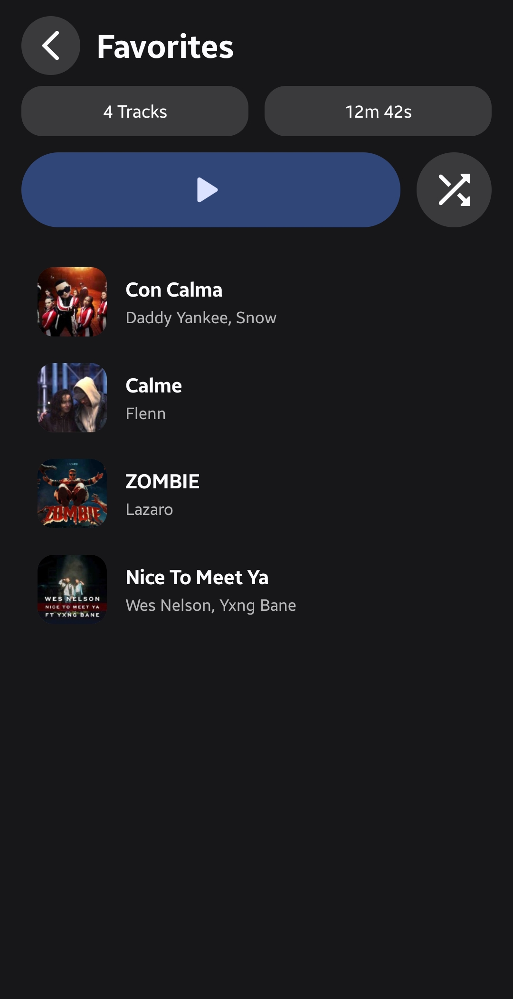

  

<h1 align="center">🎵 MFlow</h1>

  <b>Welcome to MFlow, your ultimate offline music companion designed with a modern Material 3 aesthetic and dark-mode elegance. Take full control of your local audio library with a smooth, ad-free, and privacy-focused experience built for true music lovers.</b>

---

## ✨ Key Features
* 🎵 **Seamless Local Playback**: Instantly scan, organize, and play all your device audio files with crisp quality.
* 📊 **Listening Statistics**: Track your listening habits, most played tracks, and overall stats.
* ❤️ **Favorites & Custom Playlists**: Easily manage your favorite tracks and build custom playlists tailored to your vibe.
* ⏱️ **Smart Features**: Includes real-time synced lyrics display, a mini-player for quick control, and a custom sleep timer.
* 🎨 **Dynamic Material 3 UI**: Enjoy a gorgeous, fluid interface with dynamic theming, smooth animations, and a polished dark-first design.
* 🔒 **Privacy First**: 100% offline-first architecture ensuring your data and listening habits remain completely private on your device.  

Play your way with MFlow! 🎶

---

## 📱 Screenshots

  
  
  
  
  
  

---

## 📄 License
This project is licensed under the **MIT License** - see the [LICENSE](LICENSE) file for details.
